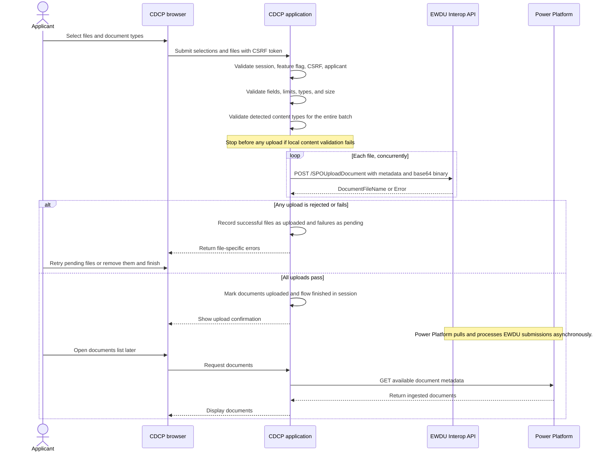

# Document upload feature

## Contents

- [Purpose and summary](#purpose-and-summary)
- [Key terms](#key-terms)
- [Scope and access](#scope-and-access)
- [Upload scenarios](#upload-scenarios)
  - [Access and flow lifecycle](#access-and-flow-lifecycle)
  - [File selection and editing](#file-selection-and-editing)
  - [Validation, scanning, and uploading](#validation-scanning-and-uploading)
  - [Recovery and completion](#recovery-and-completion)
  - [Navigation and refresh](#navigation-and-refresh)
- [End-to-end process](#end-to-end-process)
  - [Submission and validation](#1-submission-and-validation)
  - [EWDU processing](#2-ewdu-processing)
  - [Power Platform background ingestion and retrieval](#3-power-platform-background-ingestion-and-retrieval)
- [Filename and data sharing](#filename-and-data-sharing)
  - [Filename handling](#filename-handling)
  - [Data collected and shared](#data-collected-and-shared)
  - [Data kept for validation or control](#data-kept-for-validation-or-control)
- [Implementation touch points](#implementation-touch-points)
- [Configuration, security, and operations](#configuration-security-and-operations)
  - [Runtime settings](#runtime-settings)
  - [Retry behavior](#retry-behavior)
  - [Security and privacy](#security-and-privacy)
- [Failure and consistency behavior](#failure-and-consistency-behavior)

## Purpose and summary

This reference describes protected document uploads in the Canadian Dental Care Plan application for business, support, and technical teams.

Reviewed 2026-10-27.

For plain-language DEV test steps and an accessibility assessment aid, see the
[DEV testing and accessibility assessment guide](./document-upload-dev-testing-guide.md).

Applicants submit evidentiary documents through a protected MSCA form. The browser sends files to the CDCP server, which validates them and submits them to EWDU:

1. The user selects files and a document type for each file.
2. The CDCP server validates the submission and computes a SHA-256 hash for each file. It rejects files with matching filenames, sizes, and contents as duplicates.
3. The server checks each file extension and detected content type locally.
4. The server sends each validated file to EWDU through the Interop API `SPOUploadDocument` operation, which scans and uploads it in one request.
5. The server records each file's outcome in the session. Successful files remain uploaded when others fail. Retries submit only pending files. The server shows confirmation when all pending uploads succeed or the user removes the remaining files and selects the finish action.
6. Power Platform pulls and processes EWDU submissions asynchronously. The documents list shows records after that process makes them available.

EWDU scans files for threats and saves them to its drop location. Power Platform later imports the files and creates the evidentiary-document records shown in the CDCP documents list. DTS does not create Power Platform metadata during the upload request.

## Key terms

| Term                 | Meaning                                                                                                          |
| -------------------- | ---------------------------------------------------------------------------------------------------------------- |
| CDCP                 | Canadian Dental Care Plan.                                                                                       |
| MSCA                 | My Service Canada Account, the authenticated portal used to access this feature.                                 |
| EWDU                 | Enterprise Wide Document Upload, the service that scans files and saves them to its predetermined drop location. |
| Interop API          | Integration layer used by CDCP to communicate with EWDU and Power Platform.                                      |
| Power Platform       | System that stores evidentiary-document metadata and provides the submitted-documents list data.                 |
| Client ID            | Power Platform identifier for the applicant record.                                                              |
| Client number        | Applicant identifier sent to EWDU as `subjectPersonIdentificationID`.                                            |
| Evidentiary document | Document submitted as evidence for a CDCP applicant.                                                             |

## Scope and access

| Area                        | Current behavior                                                                                                                        |
| --------------------------- | --------------------------------------------------------------------------------------------------------------------------------------- |
| Feature flag                | `doc-upload` must be enabled.                                                                                                           |
| Protected upload page       | `/en/protected/documents/upload` and `/fr/protege/documents/televerser`                                                                 |
| Submitted-document list     | `/en/protected/documents` and `/fr/protege/documents`                                                                                   |
| Documents-not-required page | `/en/protected/documents/not-required` and `/fr/protege/documents/non-requis`                                                           |
| Supported target            | Primary enrolled applicant only. Child records are mapped server-side but are not currently offered in the UI.                          |
| Source route                | [`upload-index.tsx`](../../app/routes/protected/documents/upload/upload-index.tsx) starts a flow and redirects to its ID-specific form. |

The form uses the authenticated applicant context and has no applicant selector. The upload layout checks `AppealUploadEligibilityService`. It redirects to the documents-not-required page if the eligibility result is absent or `canUploadAppealDocuments` is `false`. The layout describes eligible applicants as having an application paused because of a T4 mismatch. The form loads active, localized document types and the dashboard URL.

The instructions recommend a completed CDCP Member Eligibility Review Form. They also accept a letter or email from an employer or pension plan, or another document showing no access to private dental insurance or coverage. Documents should include the applicant's matching first and last name, CDCP Member ID, and an authorized signature. The application does not check document contents for these details.

## Upload scenarios

A flow has status `initialized`, `partial-upload`, or `finished`. Each listed file is `pending` or `uploaded`. A selection with only uploaded files remains `partial-upload` until the user finishes it.

### Access and flow lifecycle

| Scenario                                                   | Outcome                                                                                                       |
| ---------------------------------------------------------- | ------------------------------------------------------------------------------------------------------------- |
| Eligible applicant enters the upload entry route           | Creates a new UUID-keyed session flow with no documents and replaces the URL with the flow-specific form URL. |
| Eligibility is absent or does not permit uploads           | Redirects to the documents-not-required page.                                                                 |
| Flow ID is invalid or the session record is unavailable    | Replaces the URL with the localized documents listing.                                                        |
| User revisits a finished form, including a POST            | Middleware redirects to that flow's confirmation before its loader or action runs.                            |
| User opens confirmation for an initialized or partial flow | Redirects to the documents listing; partial success alone does not permit confirmation.                       |
| User opens or refreshes a finished confirmation            | Shows successful filenames from the session, next steps, and a notice that account visibility may be delayed. |

### File selection and editing

| Scenario                                                                                     | Outcome                                                                                                                                             |
| -------------------------------------------------------------------------------------------- | --------------------------------------------------------------------------------------------------------------------------------------------------- |
| User selects a valid file                                                                    | Client-side selection validation adds it as pending with an empty document type; focus moves to the new item.                                       |
| User adds more files                                                                         | Appends them without discarding existing files or document types. The native picker selects one file at a time; this form renders no drop zone.     |
| User cancels the picker                                                                      | Leaves the selection unchanged.                                                                                                                     |
| Incoming selection exceeds the maximum                                                       | Rejects the entire proposed selection. Pending and uploaded files both count toward the limit.                                                      |
| Incoming selection contains an unsupported extension or oversized file                       | Rejects the entire proposed selection and displays the first selection error. A file exactly at the size limit passes size validation.              |
| Incoming selection contains a duplicate, or duplicates any listed file                       | Rejects the entire proposed selection, including duplicates of already-uploaded files.                                                              |
| Files have identical contents but different names, or identical names but different contents | The form allows them. A duplicate must match the filename, size, and SHA-256 hash.                                                                  |
| User changes a pending file's document type                                                  | Updates that file only. The selector offers active, localized types.                                                                                |
| User cancels or dismisses the removal dialog                                                 | Keeps the pending file.                                                                                                                             |
| User explicitly confirms removal                                                             | Removes that pending file; focus moves to the next or preceding pending item, the uploaded-only status region, or the upload trigger.               |
| File has already uploaded successfully                                                       | Shows its filename, document type, and success status without type-editing or removal controls. An unavailable type label has a localized fallback. |
| Selection validation response is stale                                                       | Only the response matching the current validation ID can add files.                                                                                 |

### Validation, scanning, and uploading

| Scenario                                                                                                       | Outcome                                                                                                                               |
| -------------------------------------------------------------------------------------------------------------- | ------------------------------------------------------------------------------------------------------------------------------------- |
| User submits an empty selection                                                                                | Client validation displays a required-file error without invoking the server action.                                                  |
| Pending file has no document type                                                                              | Displays a file-specific document-type error; no content check or upload occurs.                                                      |
| Submitted batch has an invalid extension, oversized file, excessive count, or duplicate files                  | Client validation blocks submission; the server repeats validation if invoked.                                                        |
| Upload payload has no file IDs, mismatched IDs and file objects, blank IDs, non-file objects, or duplicate IDs | Server returns HTTP 400 before processing file bytes.                                                                                 |
| Submitted ID belongs to an already-uploaded file in this flow                                                  | Server returns HTTP 409 without changing state.                                                                                       |
| Detected content type is not allowed                                                                           | Returns a file-specific type error before any upload request.                                                                         |
| Content type cannot be detected                                                                                | Only declared `text/plain` passes the content-type fallback; otherwise the file is rejected.                                          |
| EWDU rejects one or more files during scan-and-upload                                                          | Uses `scanFailed` for confirmed unsafe files and `uploadFailed` for other rejections; successful files remain uploaded.               |
| Local content checking throws                                                                                  | Returns an unexpected content-validation error for the affected file before upload.                                                   |
| Every pending file passes scanning and uploading                                                               | Marks files uploaded, finishes the flow, and replaces the form URL with confirmation.                                                 |
| Every upload fails                                                                                             | Keeps all submitted files pending and returns file-specific upload errors.                                                            |
| Some uploads succeed and others fail                                                                           | Retains successful files as uploaded and failed files as pending, preserving selection order; returns errors rather than redirecting. |
| EWDU returns `ErrorCode: "400"` and `ErrorMessage: "File not safe"`                                            | Displays the security-check `scanFailed` message asking the user to choose a different file. Other concurrent uploads may succeed.    |
| EWDU returns another structured rejection                                                                      | Displays the generic `uploadFailed` error for that file. Other concurrent uploads may succeed.                                        |
| Upload service has a technical failure                                                                         | Displays the generic `uploadError` error for that file. Other concurrent uploads may succeed.                                         |

### Recovery and completion

| Scenario                                                                                            | Outcome                                                                                                                                                                |
| --------------------------------------------------------------------------------------------------- | ---------------------------------------------------------------------------------------------------------------------------------------------------------------------- |
| User retries after an EWDU rejection                                                                | Revalidates and sends only pending files to EWDU for scanning and uploading.                                                                                           |
| User retries after partial upload                                                                   | Sends only pending files; successful files are not scanned or uploaded again. The UI shows separate uploaded and remaining counts and a Submit remaining files action. |
| User adds files after partial success                                                               | Retains successful uploads and appends new pending files, subject to selection limits and duplicate checks.                                                            |
| User changes types or removes failed files before retrying                                          | Uses the current pending selection; the next validated submission replaces obsolete pending session metadata while retaining successful uploads.                       |
| User removes every failed file after partial success                                                | Shows an uploaded-only success region with no files awaiting upload and a View submission confirmation action. Removing files does not itself finish the flow.         |
| User finishes an uploaded-only selection                                                            | Sends a metadata-only `finish` request; the server removes stale pending metadata and redirects to confirmation without scanning or uploading files.                   |
| User finishes without any successful uploads, or an already-finished flow reaches the finish action | Returns HTTP 409. Normal finished-route access is redirected by middleware first.                                                                                      |
| Finish payload contains file IDs, file objects, or any non-string value                             | Returns HTTP 400.                                                                                                                                                      |
| User removes all files with no successful uploads                                                   | Returns to an empty form; submission still requires a file.                                                                                                            |

### Navigation and refresh

| Scenario                                                                                        | Outcome                                                                                                                                                          |
| ----------------------------------------------------------------------------------------------- | ---------------------------------------------------------------------------------------------------------------------------------------------------------------- |
| User attempts client-side navigation to a different pathname with pending files                 | Opens a confirmation dialog. Stay, Escape, or dialog dismissal cancels navigation and restores focus; explicit Leave proceeds.                                   |
| User refreshes, closes, or otherwise unloads the browser page with pending files                | Requests the browser's native unsaved-changes warning. Browser behaviour determines whether it is shown.                                                         |
| User leaves an empty or uploaded-only selection                                                 | Does not show an unsaved-changes warning. Already-uploaded documents remain submitted.                                                                           |
| User changes only the query string or fragment                                                  | The client-side pathname guard does not block it; query changes can still lead to loader revalidation.                                                           |
| User reloads an open flow, or its form loader otherwise runs                                    | Clears both pending and uploaded session metadata and returns initialized state. This does not undo successful downstream uploads; it is not a resume mechanism. |
| Known add-files, upload, or finish POST targets the same form with unchanged pathname and query | Suppresses form-loader revalidation to preserve active flow state. Other requests use the router's default revalidation decision.                                |
| Fetcher is submitting or loading                                                                | Disables file selection, type editing, removal, and submission controls to prevent overlapping UI mutations.                                                     |

## End-to-end process



### 1. Submission and validation

The user selects files and a document type for each pending file. The application submits only pending files in a multipart request with a CSRF token. The server gets the applicant from the authenticated context, not from the submitted form. The browser validates files for immediate feedback. The server repeats validation before it accepts the submission.

The browser and server use these validation defaults:

| Setting            | Current default                                                                                             | Source                                    |
| ------------------ | ----------------------------------------------------------------------------------------------------------- | ----------------------------------------- |
| Allowed extensions | `.pdf`, `.docx`, `.rtf`, `.xlsx`, `.pptx`, `.txt`, `.jpg`, `.jpeg`, `.png`, `.gif`, `.bmp`, `.tif`, `.tiff` | `DOCUMENT_UPLOAD_ALLOWED_FILE_EXTENSIONS` |
| Maximum file size  | 5 MB per file                                                                                               | `DOCUMENT_UPLOAD_MAX_FILE_SIZE_MB`        |
| Maximum file count | 10 listed files during selection; at most 10 pending files per submitted batch                              | `DOCUMENT_UPLOAD_MAX_FILE_COUNT`          |

The application applies these rules:

- The authenticated applicant context supplies the client number.
- At least one file is required.
- The number of files must not exceed the configured maximum.
- The filename extension must be on the allow-list.
- The file size must not exceed the configured maximum.
- A document type is required for every file.
- The document-type schema checks only for a nonempty value, not membership in the active choices. The upload service resolves the submitted ID downstream.
- File selection rejects duplicates within the new selection and against all listed pending and uploaded documents. A duplicate has the same filename, size, and SHA-256 content hash. Final upload validation repeats the duplicate check within the submitted batch in both the browser and on the server.
- The server inspects file contents with `file-type`. If the library detects no type, the server accepts only a file declared as `text/plain`. A detected MIME type must map to one of the configured extensions.

Selection count and duplicate checks include uploaded files still listed in the browser. Server submission validation checks only the pending batch. It does not check the total flow count or compare file contents with earlier uploads.

The size schema has no minimum, so empty files pass size validation. Content inspection accepts any detected MIME type on the allow-list. It does not require the type to match the filename's extension.

The server reads each file while parsing the submission, computes its SHA-256 hash for duplicate validation, and converts the binary to base64 for downstream requests.

### 2. EWDU processing

The server calls `DocumentUploadService.uploadDocument()` for each file that passes local validation. The service resolves the document type ID to its configured code, maps the request to EWDU format, and calls the repository. EWDU scans and uploads the file in one request. Files upload concurrently, so a rejection does not stop other uploads.

The standalone `Scan` adapter remains available for repository health checks. The document-submission flow does not invoke it.

The upload request includes these fields:

```json
{
  "filename": "evidence.pdf",
  "binary": "<base64 file bytes>",
  "subjectPersonIdentificationID": "<client number>",
  "documentCategoryText": "<document type code>",
  "originalDocumentCreationDate": "2026-07-21T00:00:00.000Z",
  "username": "<EWDU encapsulation username>",
  "password": "<EWDU encapsulation password>",
  "programActivityIdentificationID": "<program activity ID>"
}
```

The repository sends the request to:

```text
POST {INTEROP_API_BASE_URI}/client-correspondence/document-upload/cct/v1/api/SPOUploadDocument
```

The successful response contains a nonempty `DocumentFileName`. A returned rejection contains an `ErrorCode` and `ErrorMessage`. EWDU's confirmed unsafe-file response is HTTP 400 with this payload:

```json
{
  "Error": { "ErrorCode": "400", "ErrorMessage": "File not safe" },
  "DocumentFileName": null
}
```

Both repository operations validate and return the EWDU response body when `response.ok` is true or the HTTP status is 400. They do not classify the business outcome. They throw errors for other HTTP statuses, transport failures, and invalid payloads.

The service returns `status: 'unsafe'` only for the exact code and message above. HTTP 400 or error code `400` alone is not enough. The route uses the English or French `scanFailed` message to tell the user to choose another file because this one failed security checks.

Other structured rejections return `status: 'rejected'` and use `uploadFailed`. Technical failures return `status: 'error'` and use `uploadError`. These two messages ask the user to retry. The upload service returns the original technical error to its server-side caller. The route does not include that error in the user-facing response.

The client number comes from the authenticated applicant context. `documentCategoryText` is the code that `EvidentiaryDocumentTypeService` loads for the selected Power Platform document-type ID, not its display label.

### 3. Power Platform background ingestion and retrieval

After EWDU accepts an upload, a Power Platform background process imports the documents. DTS does not post document metadata to Power Platform or wait for that process to finish.

The immediate confirmation page uses filenames stored in the DTS session. It confirms successful EWDU submission, not completed Power Platform ingestion. Documents can appear in the list later, after Power Platform makes their records available.

When the user opens the documents page, DTS reads available evidentiary-document records from Power Platform through `EvidentiaryDocumentService`:

```text
GET {INTEROP_API_BASE_URI}/dental-care/doc-metadata/pp/v1/esdc_evidentiarydocuments
```

The query filters by selected client ID and active status. It expands client and document-type relationships and sorts by upload date descending, then filename ascending. The UI displays the filename, applicant, localized document type name, and upload date. Power Platform controls when it imports documents and retries failures.

## Filename and data sharing

### Filename handling

The application does not generate a business filename. It preserves the original `File.name` supplied by the browser when the user selects a file.

- `file_id` is an internal identifier generated with `crypto.randomUUID()`. It tracks the selected file in the UI, error responses, and confirmation list; it is not sent to EWDU or Power Platform.
- The server uses the original filename for extension validation, duplicate detection, and EWDU requests. It allows files with the same name when their contents differ.
- The server does not rename, sanitize, or add a timestamp to the filename before sending it downstream.
- The server generates the upload timestamp. It does not derive it from the filename or the file's local creation date.

### Data collected and shared

| Flow                 | System behavior                                                                                                       |
| -------------------- | --------------------------------------------------------------------------------------------------------------------- |
| DTS upload           | DTS sends validated files and upload fields to EWDU. It does not send a metadata POST to Power Platform.              |
| Background ingestion | Power Platform pulls and processes EWDU submissions asynchronously. Power Platform owns ingestion timing and retries. |
| Documents list       | DTS requests available records from Power Platform when the user opens the documents page.                            |

### Data kept for validation or control

The CDCP server uses these values without sending them to EWDU or Power Platform:

- File size, used for the maximum-size check.
- Declared MIME type and detected file type, used for content validation.
- SHA-256 file hash, used with filename and size to detect duplicates during validation.
- CSRF token, used to protect the submission.
- Internal `file_id`, used to associate UI errors with selected files.

Power Platform later returns document metadata, client display names, and localized document-type names for display in the submitted-documents list.

## Implementation touch points

The implementation uses these files:

- [`upload-index.tsx`](../../app/routes/protected/documents/upload/upload-index.tsx) and [`upload-layout.tsx`](../../app/routes/protected/documents/upload/upload-layout.tsx): flow creation and appeal-upload eligibility checks.
- [`upload-form.tsx`](../../app/routes/protected/documents/upload/upload-form.tsx) and [`upload-form-loader.server.ts`](../../app/routes/protected/documents/upload/upload-form-loader.server.ts): form route, revalidation policy, loader resets, and active document types.
- [`upload-form-action.client.ts`](../../app/routes/protected/documents/upload/upload-form-action.client.ts) and [`upload-form-action.server.ts`](../../app/routes/protected/documents/upload/upload-form-action.server.ts): selection/submission dispatch, server orchestration, per-file outcomes, and explicit completion.
- [`protected-documents-upload-helpers.ts`](../../app/route-helpers/protected-documents-upload-helpers.ts) and [`protected-documents-upload-helpers.server.ts`](../../app/route-helpers/protected-documents-upload-helpers.server.ts): validate and parse files, inspect content types, and call the upload service.
- [`document-upload-route-helpers.ts`](../../app/.server/routes/helpers/document-upload-route-helpers.ts): session lifecycle and per-file metadata.
- [`upload-form-middleware.server.ts`](../../app/routes/protected/documents/upload/upload-form-middleware.server.ts), [`upload-submitted-middleware.server.ts`](../../app/routes/protected/documents/upload/upload-submitted-middleware.server.ts), and [`upload-submitted.tsx`](../../app/routes/protected/documents/upload/upload-submitted.tsx): lifecycle guards and session-based confirmation.
- [`upload-instructions.tsx`](../../app/routes/protected/documents/upload/components/upload-instructions.tsx): localized document guidance.
- [`upload-form.tsx`](../../app/routes/protected/documents/upload/components/upload-form.tsx) and [`use-document-upload-form.ts`](../../app/routes/protected/documents/upload/hooks/use-document-upload-form.ts): accessible upload controls, selection state, partial success, focus management, and multipart submission.
- [`remove-file-dialog.tsx`](../../app/routes/protected/documents/upload/components/remove-file-dialog.tsx) and [`unsaved-changes-dialog.tsx`](../../app/routes/protected/documents/upload/components/unsaved-changes-dialog.tsx): removal and navigation confirmation.
- [`document-upload-service.ts`](../../app/.server/domain/services/document-upload-service.ts): centralizes EWDU upload and scan outcome classification and technical failure logging.
- [`document-upload-repository.ts`](../../app/.server/domain/repositories/document-upload-repository.ts): EWDU HTTP URLs, headers, credentials, retries, and response handling.
- [`document-upload-dto.ts`](../../app/.server/domain/dtos/document-upload-dto.ts): scan and upload DTO contracts.
- [`document-upload-dto-mapper.ts`](../../app/.server/domain/mappers/document-upload-dto-mapper.ts): maps CDCP DTOs to EWDU request fields and resolves document-type codes.
- [`evidentiary-document-repository.ts`](../../app/.server/domain/repositories/evidentiary-document-repository.ts): Power Platform document-list retrieval and metadata adapter methods. The upload route does not invoke its metadata POST operation.
- [`evidentiary-document-service.ts`](../../app/.server/domain/services/evidentiary-document-service.ts): service used by the documents list to read available records.
- [`env-utils.ts`](../../app/.server/utils/env-utils.ts) and [`env-utils.ts`](../../app/utils/env-utils.ts): server integration settings and shared upload-limit configuration.
- [`application-routes-reference.md`](./application-routes-reference.md): protected document route list.

Inversify selects `DefaultDocumentUploadRepository` unless the `document-upload` mock is enabled. The mock checks for EICAR content and invalid binary data inside `uploadDocument()`, as EWDU does during its combined scan-and-upload request. EICAR returns the confirmed `400` and `File not safe` payload to test the security message. The mock rejects `mock-upload-failure.txt` to test recovery from other upload failures. Other mock response codes do not describe production EWDU responses.

## Configuration, security, and operations

### Runtime settings

| Setting                                   | Purpose                                            | Current default or source                                               |
| ----------------------------------------- | -------------------------------------------------- | ----------------------------------------------------------------------- |
| `INTEROP_API_BASE_URI`                    | Base URI for EWDU and Power Platform Interop APIs  | Required; environment-specific                                          |
| `INTEROP_API_SUBSCRIPTION_KEY`            | Subscription key used by both adapters             | Required; secret                                                        |
| `INTEROP_API_MAX_RETRIES`                 | Retry count for configured transient HTTP failures | `3`                                                                     |
| `INTEROP_API_BACKOFF_MS`                  | Retry backoff                                      | `100` ms                                                                |
| `HTTP_PROXY_URL`                          | Optional proxy used by the HTTP client             | Environment-specific                                                    |
| `EWDU_ENCAPSULATION_USERNAME`             | Credential added to EWDU request bodies            | `CDCP`                                                                  |
| `EWDU_ENCAPSULATION_PASSWORD`             | Credential added to EWDU request bodies            | Optional schema value; deployment secret                                |
| `EWDU_PROGRAM_ACTIVITY_ID`                | EWDU program activity identifier                   | `CDCP`                                                                  |
| `RECORD_SOURCE_API`                       | Upload-method override mapping for API source      | `775170002`                                                             |
| `RECORD_SOURCE_MSCA`                      | Upload-method override mapping for MSCA source     | `775170004`                                                             |
| `DOCUMENT_UPLOAD_ALLOWED_FILE_EXTENSIONS` | Browser and server extension allow-list            | `.pdf,.docx,.rtf,.xlsx,.pptx,.txt,.jpg,.jpeg,.png,.gif,.bmp,.tif,.tiff` |
| `DOCUMENT_UPLOAD_MAX_FILE_SIZE_MB`        | Browser and server per-file size limit             | `5`                                                                     |
| `DOCUMENT_UPLOAD_MAX_FILE_COUNT`          | Browser and server batch limit                     | `10`                                                                    |

The browser and server read upload limits from separate configuration values. Update both during deployment so the displayed limits match those the server enforces.

DTS uses the shared Interop API subscription key for EWDU requests and Power Platform document-list GET requests. Power Platform manages its background-ingestion credentials and retries outside the DTS upload flow. Keep the EWDU username, password, and program activity ID in server-side deployment configuration. Do not expose them through client environment variables.

### Retry behavior

| Operation                   | Retryable statuses currently configured |
| --------------------------- | --------------------------------------- |
| EWDU `SPOUploadDocument`    | None; POST retries are disabled         |
| Power Platform document GET | 502                                     |

`SPOUploadDocument` does not retry HTTP requests. If EWDU saves a file but DTS loses the response, another request could save it twice. DTS reports a generic upload error because it cannot confirm the outcome.

User-initiated retries submit only pending files. Power Platform manages its own background-ingestion retries. DTS has no cross-system transaction, rollback, or saved flow that users can resume after a reload. The form loader resets an open flow's metadata.

### Security and privacy

- Feature flag and authenticated-session checks run on page access and submission.
- The server validates the CSRF token before processing the multipart request.
- The server gets the client number from the authenticated applicant context, not from the upload form.
- The server sends file bytes to downstream services as base64 JSON. The application and repository do not log them.
- The repository uses an Interop API subscription key and EWDU encapsulation credentials.
- The frontend does not trust browser validation; the server repeats all upload validation.

## Failure and consistency behavior

The application processes a batch without a cross-system transaction. Each upload can succeed or fail independently:

- Validation failures stop all downstream calls for the submitted batch. A local content-validation failure also stops all uploads in that batch.
- An EWDU rejection does not undo other uploads. The application records successful files and returns a file-specific error without showing confirmation. Users can remove unsafe files and finish with the successful uploads, or retry other pending files.
- The upload contract has no idempotency key. Submitting a successful file again in a new flow can create a duplicate.
- The session supplies the immediate confirmation. The documents page retrieves records from Power Platform, which may not have imported the new files yet.
- Refreshing an open form clears its metadata, including records of successful uploads. It does not reverse those uploads. Only finished flows can show confirmation.

`DocumentUploadService` catches and logs exceptions from auditing, request mapping, and repository calls. Its server-side DTOs use these fields:

| Status     | Upload response                             | Scan response                               |
| ---------- | ------------------------------------------- | ------------------------------------------- |
| `success`  | `documentFileName`                          | `DataId`                                    |
| `unsafe`   | `error` with `errorCode` and `errorMessage` | `Error` with `errorCode` and `errorMessage` |
| `rejected` | `error` with `errorCode` and `errorMessage` | `Error` with `errorCode` and `errorMessage` |
| `error`    | `error` with the original thrown value      | No error payload                            |

The route maps these statuses to localized messages. It uses `scanFailed` for unsafe files, `uploadFailed` for other rejections, and `uploadError` for technical failures. It does not send the original technical error to the browser or retry the request.

Changes to EWDU or Power Platform must preserve these outcomes. Changes to background ingestion also require updates to Power Platform monitoring and operations.
